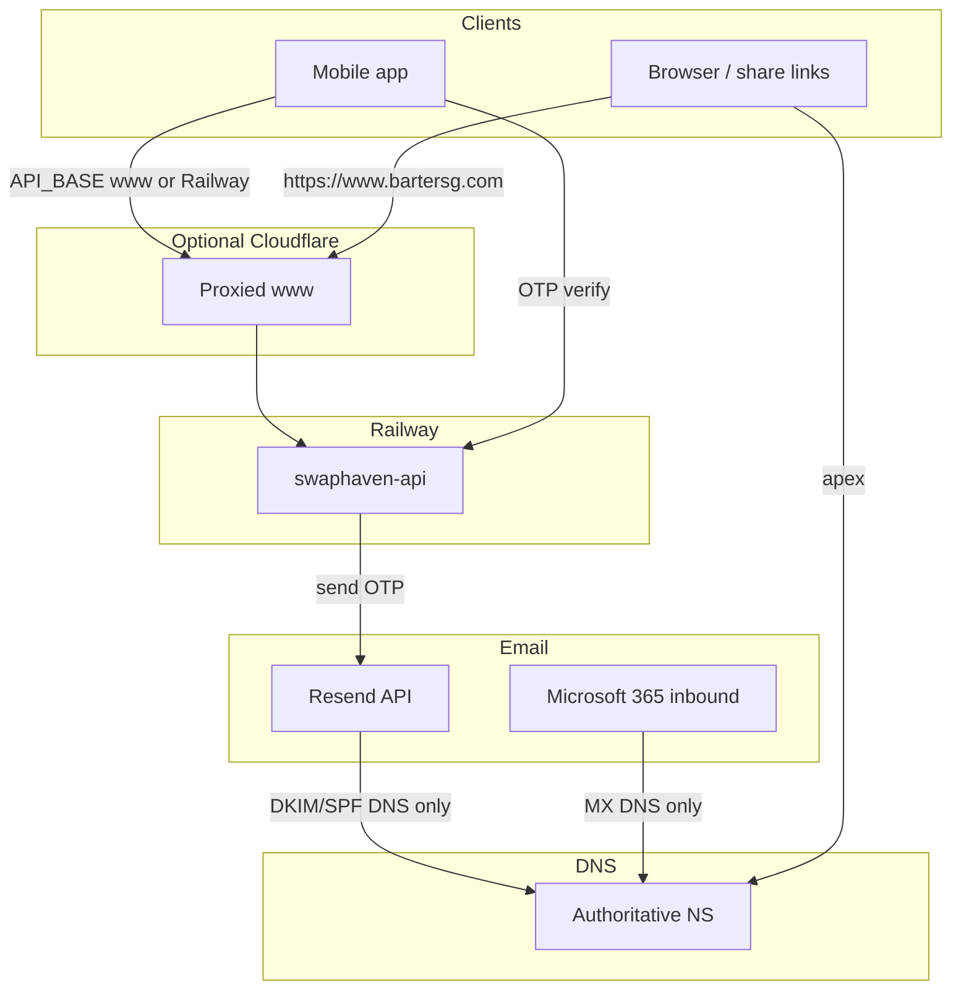

# Domain, Cloudflare, email / OTP, redirects

Canonical networking runbook for **`bartersg.com`**: registrar, DNS, Cloudflare proxy, Railway custom domain, Resend OTP mail, Microsoft 365 mailbox, and apex → `www` redirect.

Companion docs:

| Topic | Doc |
|-------|-----|
| Share / App Links / Universal Links | [SHARE_DEEP_LINKS_DNS.md](./SHARE_DEEP_LINKS_DNS.md) |
| Email OTP signup | [CREATE_ACCOUNT_OTP.md](./CREATE_ACCOUNT_OTP.md) |
| Activity digest email | [ACTIVITY_EMAIL_AND_PRESENCE.md](./ACTIVITY_EMAIL_AND_PRESENCE.md) |
| Railway → EC2 | [EC2_MIGRATION.md](./EC2_MIGRATION.md) |
| CDN country for discovery | `GET /api/geo/me` (`CF-IPCountry`) — see `src/lib/geo-country.ts` |

**Do not commit secrets** (`RESEND_API_KEY`, Railway tokens, Cloudflare API tokens). This file only holds **public DNS** values and ops rules.

---

## 1. Roles (who does what)

| Piece | Provider | Role |
|-------|----------|------|
| Domain registration | GoDaddy | Owns `bartersg.com` |
| Authoritative DNS | GoDaddy **or** Cloudflare (after NS cutover) | MX, TXT, CNAME, A, SRV |
| HTTP edge / geo header | Cloudflare (proxied `www`) | TLS at edge, `CF-IPCountry` → API |
| API + preview HTML + `.well-known` | Railway (`swaphaven-api`) | Origin behind `www` |
| Transactional email (OTP, activity) | Resend | Outbound API mail; domain DKIM in DNS |
| Mailbox / inbound | Microsoft 365 (Outlook) | `MX` → `*.mail.protection.outlook.com` |
| Apex browser redirect | GoDaddy forwarding **or** Cloudflare Page Rule / Redirect | `bartersg.com` → `https://www.bartersg.com` |

Canonical product host: **`https://www.bartersg.com`** (API, shares, App Links). Bare apex is redirect-only for browsers.



---

## 2. Recovery snapshot (pre–Cloudflare activation)

Captured **2026-10-19** via public DNS (`dig`) while nameservers were still **GoDaddy**:

```text
NS:  ns03.domaincontrol.com.
     ns04.domaincontrol.com.
```

Use this table to restore DNS if a Cloudflare import/edit goes wrong. Values are **public**; recreate them exactly in the DNS UI (Cloudflare or GoDaddy).

### 2.1 Apex / website

| Type | Name | Content | Notes |
|------|------|---------|--------|
| A | `@` / `bartersg.com` | `3.33.251.168` | GoDaddy forwarding / parking |
| A | `@` / `bartersg.com` | `15.197.225.128` | GoDaddy forwarding / parking |
| CNAME | `www` | `oya2f7mh.up.railway.app` | Railway custom domain for API |
| TXT | `_railway-verify.www` | `railway-verify=6062f695e5260df886b7762535bb77b63a7cdc97dc6394371f295fd4bc323500` | Railway ownership proof for `www` — **often missing from Cloudflare import**; add manually (**DNS only**) |
| CNAME | `_domainconnect` | `_domainconnect.gd.domaincontrol.com` | GoDaddy Domain Connect |

### 2.2 Microsoft 365 / Outlook

| Type | Name | Content | Priority / data |
|------|------|---------|-----------------|
| MX | `@` | `bartersg-com.mail.protection.outlook.com` | Priority **0** |
| TXT | `@` | `NETORGFT20940246.onmicrosoft.com` | Microsoft tenant proof |
| TXT | `@` | `v=spf1 include:secureserver.net -all` | SPF (as published at snapshot) |
| TXT | `_dmarc` | `v=DMARC1; p=quarantine; adkim=r; aspf=r; rua=mailto:dmarc_rua@onsecureserver.net;` | DMARC |
| CNAME | `autodiscover` | `autodiscover.outlook.com` | Autodiscover |
| CNAME | `lyncdiscover` | `webdir.online.lync.com` | Teams / Skype for Business |
| CNAME | `msoid` | `clientconfig.microsoftonline-p.net` | Microsoft Online |
| CNAME | `sip` | `sipdir.online.lync.com` | SIP |
| CNAME | `selector1._domainkey` | `selector1-bartersg-com._domainkey.netorgft20940246.q-v1.dkim.mail.microsoft` | M365 DKIM |
| CNAME | `selector2._domainkey` | `selector2-bartersg-com._domainkey.netorgft20940246.q-v1.dkim.mail.microsoft` | M365 DKIM |
| CNAME | `email` | `email.secureserver.net` | GoDaddy / legacy email helper |
| SRV | `_sip._tls` | `100 1 443 sipdir.online.lync.com` | |
| SRV | `_sipfederationtls._tcp` | `100 1 5061 sipfed.online.lync.com` | |

### 2.3 Resend / outbound OTP (and `send` subdomain)

| Type | Name | Content | Notes |
|------|------|---------|--------|
| TXT | `resend._domainkey` | `p=MIGfMA0GCSqGSIb3DQEBAQUAA4GNADCBiQKBgQCuqT/xBCqNnaF/Smor7lGXF8xuamTZJ61ufRkp4zDiTOazPjaNHtm0URU1QlXKhzeT4keqpuRJfBQ2LgghgiSHW6jadVnbQ63ClYgYZtATJjcOBwFP5+6zxG1+bnIhjIiRoyBaurczSjO9B3B1sx1ST73VOQTPDaaiqmHl3uewkwIDAQAB` | Resend DKIM public key |
| MX | `send` | `feedback-smtp.ap-northeast-1.amazonses.com` | Priority **10** (bounce/feedback) |
| TXT | `send` | `v=spf1 include:dc-fd741b8612._spfm.send.bartersg.com ~all` | SPF for `send` |

App mailer: Resend API (`RESEND_API_KEY` + `EMAIL_FROM` on Railway). OTP does **not** depend on proxied CNAMEs; it depends on Resend remaining **Verified** and these **TXT** records staying intact.

### 2.4 Cloudflare proxy policy (always)

| Record | Required proxy |
|--------|----------------|
| MX (all) | **DNS only** |
| TXT (all, incl. SPF / DMARC / Resend / `_railway-verify.www`) | **DNS only** |
| SRV (all) | **DNS only** |
| `autodiscover`, `email`, `lyncdiscover`, `msoid`, `sip` | **DNS only** |
| `selector1._domainkey`, `selector2._domainkey` | **DNS only** |
| `_domainconnect` | **DNS only** (optional to keep) |
| Apex `A` (GoDaddy forward IPs) | **DNS only** until apex redirect is moved to Cloudflare |
| `www` → Railway | **DNS only** until zone Active; then **Proxied** for `CF-IPCountry` / edge |

### 2.5 Cloudflare DNS state — before activation (2026-10-19)

Snapshot from Cloudflare **DNS management** (zone not Active yet; NS still GoDaddy until you change them). Record **values** match §2.1–2.3. Proxy flags as last reviewed:

| Type | Name | Proxy (this snapshot) | OK? |
|------|------|------------------------|-----|
| A | `bartersg.com` (`15.197.225.128`) | DNS only | Yes |
| A | `bartersg.com` (`3.33.251.168`) | DNS only | Yes |
| CNAME | `autodiscover` | DNS only | Yes |
| CNAME | `_domainconnect` | DNS only | Yes |
| CNAME | `email` | DNS only | Yes |
| CNAME | `lyncdiscover` | DNS only | Yes |
| CNAME | `msoid` | DNS only | Yes |
| CNAME | `selector1._domainkey` | DNS only | Yes |
| CNAME | `selector2._domainkey` | DNS only | Yes |
| CNAME | `sip` | DNS only | Yes |
| CNAME | `www` → `oya2f7mh.up.railway.app` | **Proxied** (set in CF UI 2026-10-19) | Yes — takes effect after NS → Active |
| MX | `@`, `send` | DNS only | Yes |
| SRV | `_sip._tls`, `_sipfederationtls._tcp` | DNS only | Yes |
| TXT | `@` (tenant + SPF), `_dmarc`, `_railway-verify.www`, `resend._domainkey`, `send` | DNS only | Yes |

**Activation (2026-10-19):** Cloudflare Overview shows domain protected / Active. GoDaddy nameservers = `danica` / `troy`. In DNS UI, **only `www` is Proxied**; everything else **DNS only**.

**Verified after Active** (via Cloudflare/Google DoH → CF anycast `104.21.21.47` / `172.67.196.104`):

- `https://www.bartersg.com/api/healthz` → `server: cloudflare`, `cf-ray` present
- `https://www.bartersg.com/api/geo/me` → `"source":"header"` (receives `CF-IPCountry`)
- MX / Resend DKIM / `_railway-verify.www` still resolve

Some recursive resolvers may still cache old GoDaddy NS for a short time; whois already lists Cloudflare NS.

**Apex redirect (done 2026-10-19; confirmed live 2026-10-21):** Cloudflare **Redirect Rule** — if `http.host eq "bartersg.com"` → Dynamic `concat("https://www.bartersg.com", http.request.uri.path)`, status **301**, preserve query string. Apex `A` records are **Proxied** (required for the rule). Public `https://bartersg.com/` → **301** `Location: https://www.bartersg.com/`.

**Yellow ⚠ on some already-grey CNAMEs** (`autodiscover`, `_domainconnect`, `lyncdiscover`, `msoid`, `sip`): usually Cloudflare noting an external / non-proxied CNAME target. Safe to ignore if the cloud is grey. Hover/click the icon for the exact message. A yellow ⚠ on an **orange** mail row means “turn it grey.”

**Import gap (resolved in UI):** Cloudflare initially omitted `_railway-verify.www`; it was added manually (value in §2.1). Keep it **DNS only**.

---

## 3. Cloudflare cutover checklist

1. **Backup** — keep §2 of this file; optionally export DNS from GoDaddy (zone file / screenshots).
2. **Fix proxy flags** — §2.5 done (everything grey, including both DKIM selectors; `www` stays grey until Active).
3. **Continue to activation** → at registrar (GoDaddy), replace nameservers (2026-10-19 Cloudflare assignment for `bartersg.com`):

| Action | Nameserver |
|--------|------------|
| **Add** | `danica.ns.cloudflare.com` |
| **Add** | `troy.ns.cloudflare.com` |
| **Remove** | `ns03.domaincontrol.com` |
| **Remove** | `ns04.domaincontrol.com` |

   GoDaddy: Domain → **DNS** / **Nameservers** → **Change** → **Enter my own nameservers** → paste the two Cloudflare hosts exactly → Save.  
   Ensure **DNSSEC is off** at GoDaddy (Cloudflare recommends this for cutover).  
   Do **not** delete DNS *records* in GoDaddy after NS change — Cloudflare becomes authoritative; GoDaddy’s record UI may stop mattering.

4. Wait until Cloudflare zone status is **Active** (minutes to ~24h; often under an hour).
5. Confirm with dig (expect Cloudflare NS, same MX/TXT/www target):

```bash
dig +short NS bartersg.com
# expect: danica.ns.cloudflare.com / troy.ns.cloudflare.com
dig +short MX bartersg.com
dig +short CNAME www.bartersg.com
dig +short TXT resend._domainkey.bartersg.com
dig +short TXT _railway-verify.www.bartersg.com
```

6. **Proxy only `www`** (orange). Leave mail records grey.
7. **Apex redirect** — after NS move, GoDaddy domain-forwarding may stop applying. On Cloudflare, add a redirect rule: `bartersg.com` → `https://www.bartersg.com` (301), or point apex at Railway if you adopt CNAME flattening later.
8. Railway: confirm custom domain **`www.bartersg.com`** still Active / cert OK.
9. API: production should have `TRUST_PROXY=true` (default when `NODE_ENV=production`) so Express trusts `X-Forwarded-*` / Cloudflare.
10. Mobile `API_BASE` / `SHARE_BASE_URL` should use `https://www.bartersg.com` when you want geo headers and share host aligned (see [SHARE_DEEP_LINKS_DNS.md](./SHARE_DEEP_LINKS_DNS.md)).

### Why proxy `www`?

| Goal | Needs proxied `www`? |
|------|----------------------|
| `CF-IPCountry` on `GET /api/geo/me` and swipe country | **Yes** — client must hit the Cloudflare hostname |
| OTP / Resend | **No** — API → Resend; DNS TXT only |
| Outlook inbox | **No** — MX must stay DNS only |
| Share / App Links | Works with or without proxy if DNS still points at Railway; proxy is fine if SSL mode is Full (strict) |

Free Cloudflare plan is enough for this.

---

## 4. Email & OTP — what breaks / what does not

| Change | OTP (Resend) | Outlook inbox | Autodiscover |
|--------|--------------|---------------|--------------|
| NS → Cloudflare, records unchanged | OK | OK | OK |
| Orange-proxy `www` only | OK | OK | OK |
| Delete / edit Resend `resend._domainkey` | **Breaks / spam** | OK | OK |
| Delete root SPF / DMARC carelessly | Deliverability risk | Possible impact | — |
| Orange-proxy `autodiscover` / `sip` / DKIM CNAMEs | Usually OK | Often OK for MX | **Breaks** |
| Delete MX | OK for OTP send | **Breaks inbound** | — |

Recovery if OTP fails after DNS work:

1. Resend dashboard → Domains → `bartersg.com` (or sending domain) still **Verified**.
2. `dig TXT resend._domainkey.bartersg.com` matches §2.3.
3. Railway still has `RESEND_API_KEY` + `EMAIL_FROM`.
4. Send a test register / password-reset OTP; check Resend logs.

---

## 5. Redirects & hostnames

| Host | Expected behaviour |
|------|--------------------|
| `https://www.bartersg.com` | Railway API (health, `/api/*`, listing/profile HTML, `/.well-known/*`) |
| `https://bartersg.com` | **301/302** → `https://www.bartersg.com` (browsers only; not App Links host) |
| `*.up.railway.app` | Direct Railway URL (works; **no** `CF-IPCountry` unless you add another CDN) |

Verify:

```bash
curl -sS https://www.bartersg.com/api/healthz
curl -sSI https://bartersg.com | head -n 15
curl -sS https://www.bartersg.com/api/geo/me
# After orange www + phone on cellular abroad, country should match CDN (not always SG fallback)
```

---

## 6. Env vars (networking-related)

| Variable | Where | Purpose |
|----------|-------|---------|
| `RESEND_API_KEY` | Railway | Send OTP / transactional mail |
| `EMAIL_FROM` | Railway | Verified Resend From (must match verified domain) |
| `TRUST_PROXY` | Railway | `true` in production behind Cloudflare / Nginx |
| `API_BASE` | Mobile env | Prefer `https://www.bartersg.com` for geo + same-origin API |
| `SHARE_BASE_URL` | Mobile env | `https://www.bartersg.com` |

Never put API keys in this markdown file.

### 6.1 After Cloudflare is live — Railway + app checklist

**Railway (production service that owns `www.bartersg.com`):**

1. **Settings → Networking → Custom Domain:** confirm `www.bartersg.com` is still **Active** (cert OK). No new domain needed — Cloudflare CNAME already points at this service.
2. **Variables:** `TRUST_PROXY=true` (or omit — production defaults to trusting the proxy). No Cloudflare-specific env var is required; `CF-IPCountry` is a request header.
3. Keep the `*.up.railway.app` URL — fine for direct debug; it **bypasses** Cloudflare (no country header).
4. Cloudflare **SSL/TLS → Overview:** mode **Full (strict)** so CF talks HTTPS to Railway.

**Mobile app:**

| Env file | `API_BASE` | Notes |
|----------|------------|--------|
| `production.env` | `https://www.bartersg.com` | Done (2026-10-21) — prod builds hit Cloudflare for `CF-IPCountry` / geo. |
| `uat.env` | Keep `https://swaphaven-backend-uat.up.railway.app` | `www` is production only unless you add e.g. `uat.bartersg.com`. |
| Both | `SHARE_BASE_URL=https://www.bartersg.com` | Already correct — leave it. |

Rebuild the app after changing `API_BASE` (env is baked at build time). Verify on device: discovery / `GET /api/geo/me` should show `"source":"header"` when using the www host.

---

## 7. Rollback

### 7.1 Cloudflare not Active yet

Stay on GoDaddy NS; discard or fix Cloudflare zone records; no user impact until NS change.

### 7.2 After NS pointed at Cloudflare

1. In Cloudflare DNS, recreate any missing rows from §2.
2. Set all mail-related records to **DNS only**.
3. If apex redirect broken: add Cloudflare Redirect Rule, or temporarily restore GoDaddy NS (`ns03` / `ns04.domaincontrol.com`) and re-apply GoDaddy forwarding + §2 records on GoDaddy.

### 7.3 Railway `www` broken

Confirm CNAME `www` → `oya2f7mh.up.railway.app` (or current Railway target from Railway UI). Re-add Railway custom domain / verify TXT if Railway asks for it.

---

## 8. When values change

After any intentional DNS edit, update **§2** in this file (date + table) and note the reason in the commit message. Prefer refreshing from `dig`, not from memory.

```bash
dig +short NS bartersg.com
dig +short A bartersg.com
dig +short CNAME www.bartersg.com
dig +short MX bartersg.com
dig +short MX send.bartersg.com
dig +short TXT bartersg.com
dig +short TXT _dmarc.bartersg.com
dig +short TXT resend._domainkey.bartersg.com
dig +short TXT send.bartersg.com
```
