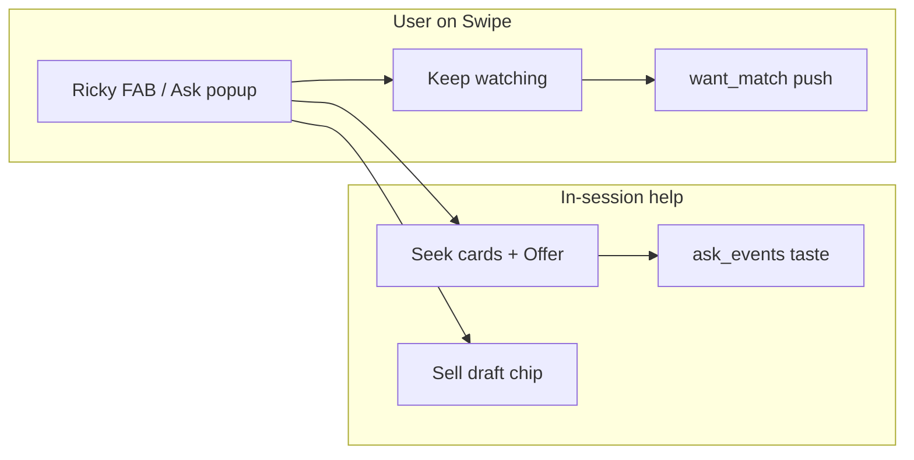
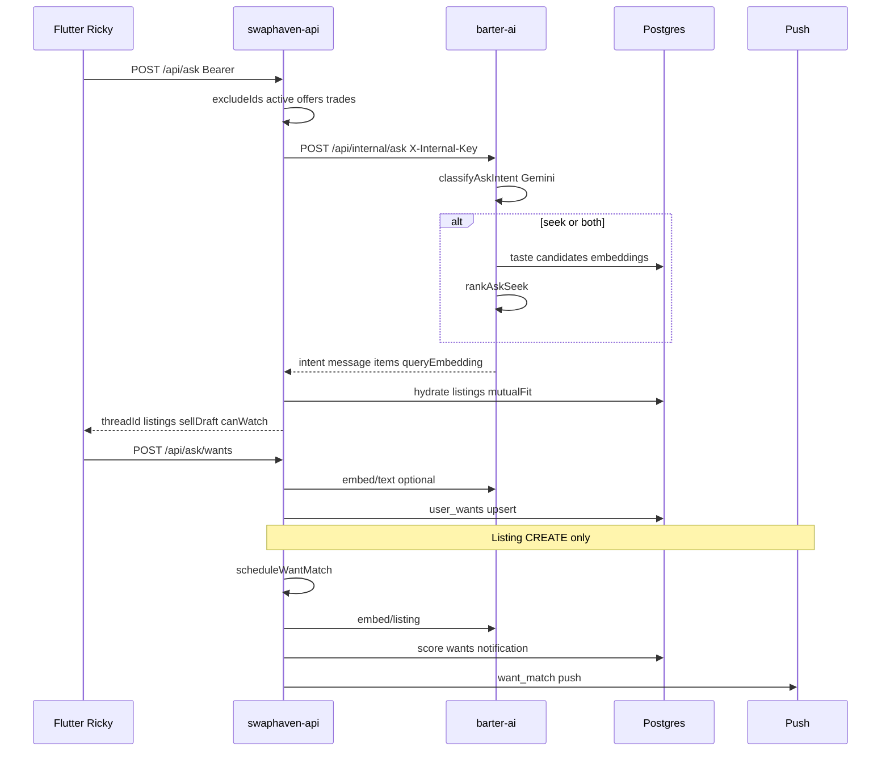

# Ricky Ask

End-to-end reference for **Ricky / Ask**: conversational seek & sell on the Swipe tab, ranked listing cards, Keep watching wants, and `want_match` re-engagement across `swaphaven-api`, `barter-ai`, and `barter-stack/mobile`.

**Ricky** is the mobile mascot / UI surface. **Ask** is the product feature (HTTP + AI + wants). Schema is owned by swaphaven-api (migration `0040_ask_wants.sql`) and mirrored into barter-ai / admin as a read-only snapshot.

Mobile pointer: [barter-stack `mobile/docs/RICKY_ASK.md`](../../barter-stack/mobile/docs/RICKY_ASK.md).

---

## 1. Product overview

| Goal | What the user gets |
|------|--------------------|
| Ask in natural language | Free-form text (and optional voice) on Swipe — not keyword search |
| Find barter-ready items | ~8 ranked cards with match reasons and optional closet suggestion |
| Start a listing from chat | Sell / both intent returns a `sellDraft` → Create Listing prefill |
| Watch the market | **Keep watching** saves a want; push + in-app `want_match` when a new listing fits |
| Teach the ranker | Card select / dismiss / offer → `ask_events` (taste signal in barter-ai) |

### Ask vs Search

| | **Search** | **Ricky Ask** |
|---|------------|---------------|
| Intent | Browse catalog with keywords / filters | Clarify vague goals; seek or sell |
| Input | Query + filters + sort | Chat (multi-turn `threadId` + `prior`) |
| Auth | Guest-friendly | Sign-in required for submit / watch / notifications |
| Engine | SQL (and some recommend hubs) | Gemini intent + embeddings + taste |
| Limits | Pagination | Client daily quota (`ricky_ask`) + API 60 asks/hour |
| Alerts | None from search box | `user_wants` → `want_match` |

When Ask is unavailable, clients show a friendly 503 and steer users to Search or swipe.



---

## 2. System architecture



| Layer | Responsibility |
|-------|----------------|
| **Mobile** | Swipe overlay UI, session state, client quota, deep links |
| **swaphaven-api** | Public Ask HTTP, listing hydration, wants CRUD, want-match fanout, push |
| **barter-ai** | Intent (Gemini), seek rank, text/listing embeddings |
| **Postgres** | `ask_events`, `user_wants`, `notifications` (`want_match`) |

---

## 3. Mobile (barter-stack)

### Placement

- Lives **only on Swipe** (`SwipeDiscoveryScreen`) — no dedicated tab.
- **FAB** (`AskPetFab`): draggable Ricky avatar, compose dock, voice, notifications bell.
- **Popup** (`AskPopup`): thread UI when open; pinned above bottom nav / keyboard.
- Visibility: Remote Config `ricky_ask.enabled` + daily quota remaining (`rickyAskQuotaProvider`).

### Key files

| Path | Role |
|------|------|
| `mobile/lib/features/discovery/presentation/swipe_discovery_screen.dart` | Hosts FAB / popup, layout, drag bounds |
| `.../presentation/ask/ask_pet_fab.dart` | Ricky avatar (`RickyPainter` / `RickyAvatar`), dock, voice, drag |
| `.../presentation/ask/ask_popup.dart` | Thread, listing cards, sell chip, Keep watching, composer |
| `.../presentation/ask/ask_composer.dart` | Bottom text field (hint: “Trade on Barter”) |
| `.../presentation/ask/ask_voice.dart` | `speech_to_text` wrapper |
| `.../notifications/presentation/ricky_notifications_panel.dart` | Bell popover (`GET /api/notifications`) |
| `.../domain/entities/ask_entities.dart` | `AskTurn`, `AskSession`, intents, cards, sell draft |
| `.../domain/entities/ricky_ask_config.dart` | RC config + quota snapshot |
| `.../application/submit_ask_use_case.dart` | Submit turn |
| `.../application/record_ask_event_use_case.dart` | `selected` / `dismissed` / `offered` |
| `.../application/save_ask_want_use_case.dart` | Keep watching |
| `.../data/datasources/ask_remote_data_source.dart` | JSON ↔ entities |
| `.../di/ask_providers.dart` | Session, popup open, FAB offset, use cases |
| `.../di/ricky_ask_quota_providers.dart` | RC + daily usage |
| `mobile/lib/core/storage/storage.dart` | `RickyAskPrefs` per-user daily counter |
| `mobile/lib/core/services/api_endpoints.dart` | `/api/ask`, `/events`, `/wants` |
| `mobile/lib/core/notifications/notification_deep_link.dart` | `want_match` parse |
| `mobile/lib/core/notifications/push_notification_service.dart` | Push → listing detail |
| `packages/barter_remote_config/.../remote_config_keys.dart` | `ricky_ask` |
| `packages/barter_remote_config/.../remote_config_defaults.dart` | Default JSON |

### Session & navigation

| Action | Navigation / effect |
|--------|---------------------|
| Submit ask | `POST /api/ask`; increment client quota on success |
| Open card | Listing detail + `recordEvent(selected)`; clear thread |
| Offer | Make offer (+ optional closet preselect) + `offered`; clear thread |
| Dismiss card | `dismissed`; clear thread |
| Sell chip | Create listing with draft values; clear thread |
| Keep watching | `POST /api/ask/wants`; toast; clear on success |
| `want_match` push / feed tap | `AppRoute.listingDetail(listingId)` |

Thread and FAB position are **in-memory only** (lost on kill / `close()`).

### Client quota (`ricky_ask`)

```json
{ "enabled": true, "dailyPromptLimit": 5 }
```

- Stored usage: SharedPreferences `barter_ricky_ask_usage_{userId}` → `{ date, count }` (local calendar day).
- Increment only after a **successful** submit HTTP response.
- **Not** enforced by the API beyond the 60/hour rate limit.
- Defaults currently diverge: `RickyAskConfig.defaults` / some docs use **5**; package `remote_config_defaults` may ship **20** — treat Remote Config as source of truth in prod.

### Mobile gaps

- No UI for `GET` / `DELETE` wants (write-only Keep watching).
- `ApiEndpoints.askWant(id)` unused.
- No dedicated Ask analytics events.
- Session cleared after most engagement actions (weak resume).

---

## 4. swaphaven-api

### Routes (`src/routes/ask.ts`)

Mounted at `/api/ask` in `src/app.ts`.

| Method | Path | Auth | Purpose |
|--------|------|------|---------|
| `POST` | `/api/ask` | Bearer + 60/hr/user (skipped in dev/test) | Proxy barter-ai; hydrate cards; `canWatch` |
| `POST` | `/api/ask/events` | Bearer | Insert `ask_events` |
| `POST` | `/api/ask/wants` | Bearer | Upsert active want |
| `GET` | `/api/ask/wants` | Bearer | List active wants (max 50) |
| `DELETE` | `/api/ask/wants/:wantId` | Bearer | Pause want |

#### `POST /api/ask`

- **Body:** `text` (required); optional `threadId`, `country`, `prior` (intent/query/category/constraints).
- **threadId:** client or server UUID; reuse for events/wants in one thread.
- **Exclusions:** listings in active negotiation (`getActiveNegotiationListingIds`).
- **Upstream:** `askBarterAi()` → `POST {BARTER_AI_URL}/api/internal/ask` with `CANONICAL_CATEGORIES`.
- **Enrichment:** images, owner, `computeMatchScore` / `suggestedClosetListingId`, merge AI reason/score.
- **Response:** `intent`, `query`, `categorySlug`, `constraints`, `message`, `listings[]`, `sellDraft` (+ `categoryId`), `queryEmbedding`, `canWatch` (`seek` \| `both`).
- **Errors:** barter-ai failures → **503** `{ error: "ask_unavailable", message: "Ask is temporarily unavailable. Try search or swipe." }` (also remapped in `askBarterAi` from upstream 502/`barter_ai_*`).

#### Events

Kinds: `selected` \| `dismissed` \| `offered`. Stored for barter-ai taste — not used for ranking inside swaphaven-api.

#### Wants

- Normalize query: trim → lower → collapse whitespace → `query_normalized`.
- Partial unique index on `(user_id, query_normalized)` WHERE `status = 'active'`.
- Embedding: client `embedding` or `embedText()` via barter-ai.

### Schema (migration `drizzle/0040_ask_wants.sql`)

Defined in `src/db/schema/ask.ts`.

| Table | Notes |
|-------|--------|
| `ask_events` | `user_id`, `listing_id`, `kind`, optional `thread_id` |
| `user_wants` | `query_text`, `query_normalized`, `embedding real[]`, `category_slug`, `status` (`active`/`paused`/`fulfilled`), `last_notified_at` |

`notification_type` includes **`want_match`** (`src/db/schema/notifications.ts`).

### Proxy (`src/lib/barter-ai.ts`)

| Helper | Internal path | Timeout |
|--------|---------------|---------|
| `askBarterAi` | `POST /api/internal/ask` | 25s |
| `embedText` | `POST /api/internal/embed/text` | 15s |
| `embedListingAwait` | `POST /api/internal/embed/listing` | 15s |

Requires `BARTER_AI_URL` + `BARTER_AI_SECRET`. Unconfigured Ask → 503 `ask_unavailable`.

### Want-match (`src/lib/want-match.ts`)

**Trigger:** `scheduleWantMatch(listingId)` on listing **create** only (`src/routes/listings.ts`). Not on PATCH relist / edit.

**Scoring (summary):**

1. Best-effort `embedListingAwait`.
2. Active wants (fanout capped), exclude owner.
3. Score ≈ semantic cosine + category hint; threshold **0.72**.
4. One want per user; notify ≤ **200**; **24h** cooldown on `last_notified_at` unless score is very high.
5. Insert notification + `sendPushToUser` (`type: want_match`, APNS category `BARTER_WANT_MATCH`).

Fire-and-forget — must not block listing create.

### Offer fulfill (`fulfillWantsOnOffer`)

From offer create (`src/routes/offers.ts`): if buyer has a `want_match` notification for that listing, mark matching active wants **fulfilled** (title/category heuristics).

### `expireStaleWants`

Exported helper marks wants older than 30 days as `fulfilled`. **Not scheduled** — no cron / startup caller today.

### OpenAPI & tests

- OpenAPI tag **Ask** in `src/openapi/spec.ts`.
- `tests/ask.test.ts`: auth 401s; mocked upstream failure → friendly 503.

### API key files

| File | Role |
|------|------|
| `src/routes/ask.ts` | Public Ask + wants + events |
| `src/lib/barter-ai.ts` | Proxy + remaps |
| `src/lib/want-match.ts` | Match, notify, fulfill, expire |
| `src/db/schema/ask.ts` | Tables / enums |
| `src/routes/listings.ts` | `scheduleWantMatch` on create |
| `src/routes/offers.ts` | `fulfillWantsOnOffer` |
| `src/lib/push.ts` | `want_match` payload |
| `drizzle/0040_ask_wants.sql` | Migration |

---

## 5. barter-ai

Internal only (`X-Internal-Key` = `INTERNAL_API_SECRET`).

### `POST /api/internal/ask` (`src/routes/internal.ts`)

1. `classifyAskIntent` — Gemini JSON (`src/ask/intent.ts`): `seek` \| `sell` \| `both` \| `unclear`, query, categorySlug, constraints, sellDraft, message.
2. If `seek` or `both`: `rankAskSeek` (`src/ask/rank.ts`).
3. Return items + `queryEmbedding`.

### Seek rank (weights)

Approx: `0.45` query semantic + `0.25` taste + `0.2` mutual fit + `0.1` category (+ keyword boost). Taste includes ask events (`src/recommend/taste.ts`): `offered`/`selected` **+3**, `dismissed` **−0.5**.

**Gap:** intent `constraints.brand` (and condition) are returned to clients but **not** applied as hard filters in rank (value cap can filter).

### Embeddings

| Path | Role |
|------|------|
| `POST /api/internal/embed/text` | Query / want embedding |
| `POST /api/internal/embed/listing` | Listing vector for match + rank |

Requires `OPENAI_API_KEY` for embeddings; `GEMINI_API_KEY` for intent. Without Gemini, Ask fails upstream → API 503.

### Tests

`tests/internal-ask.test.ts` — key/body validation + mocked happy path.

---

## 6. Environment

| Service | Variables |
|---------|-----------|
| swaphaven-api | `BARTER_AI_URL`, `BARTER_AI_SECRET` |
| barter-ai | `INTERNAL_API_SECRET` (matches API secret), `GEMINI_API_KEY`, `OPENAI_API_KEY`, shared `DATABASE_URL` |
| Mobile | Remote Config `ricky_ask`; speech / mic permissions for voice |

---

## 7. Known gaps

| Gap | Detail |
|-----|--------|
| Want-match on create only | Relist / edit does not re-fanout |
| No backfill on Keep watching | Existing inventory is not scored when a want is saved |
| `expireStaleWants` unused | No scheduler |
| Mobile wants UI missing | GET/DELETE exist on API only |
| Client-only daily quota | Easy to diverge from RC defaults (5 vs 20) |
| Brand constraint unused in rank | Returned on Ask response, not enforced |
| Few want-match tests | No integration coverage for fanout / fulfill |
| Ephemeral Ask thread | Cleared after offer / dismiss / watch |

---

## 8. Future / parked (do not implement in this doc change)

Parked product enhancements for later re-engagement work:

1. **Backfill on Keep watching** — score live inventory immediately when a want is saved.
2. **My watches UI** — list / pause / delete via existing GET/DELETE wants.
3. **Digests & soft check-ins** — periodic “N new matches” / “Still looking?” pushes.
4. **Schedule `expireStaleWants`** — cron or worker; consider distinct expired status.
5. **Want-match on relist** — fanout when paused → active (and optionally on material edits).
6. **Sharper push copy** — closet mutual-fit in notification body; deep link to offer when possible.
7. **Keep thread after watch** — resume chip instead of always clearing chat.
8. **Align RC defaults** — single `dailyPromptLimit` source; consider server-side daily quota if abuse becomes an issue.

---

## 9. Mental model

1. **Ask turn** = classify + optional rank (barter-ai) + closet-aware cards (API).
2. **Ask events** = training signal for the next in-app rank.
3. **user_wants** = async alert subscription (normalized query + embedding).
4. **want_match** = reactive fanout on **new listing publish**, not on Ask results themselves.
5. **fulfill** = buyer offered on a listing they were notified about; wants close heuristically.

---

## 10. Related docs

- [SEARCH_FEATURE.md](./SEARCH_FEATURE.md) — catalog search (contrast with Ask)
- [SEARCH_RECOMMENDATIONS.md](./SEARCH_RECOMMENDATIONS.md) — barter-ai recommend hubs
- Push / deep links: [deeplink-push-notifications.md](./deeplink-push-notifications.md)
- Mobile feature log: [barter-stack `mobile/docs/FEATURE_LOG.md`](../../barter-stack/mobile/docs/FEATURE_LOG.md)
